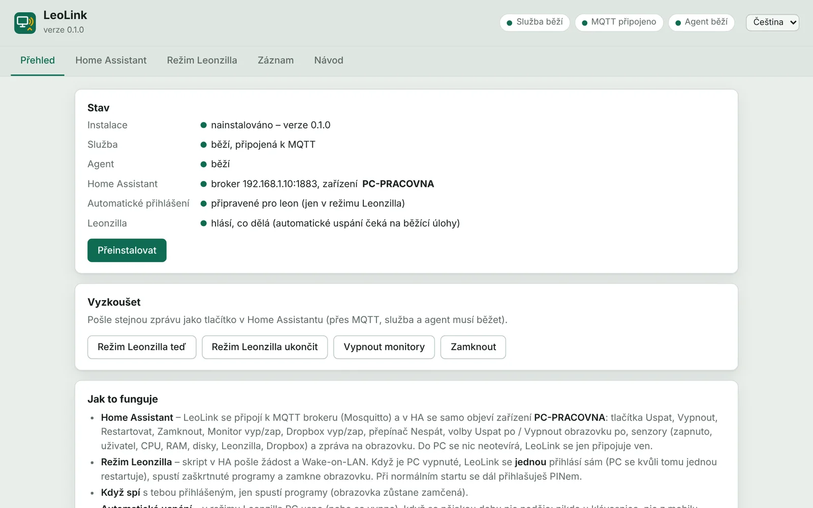
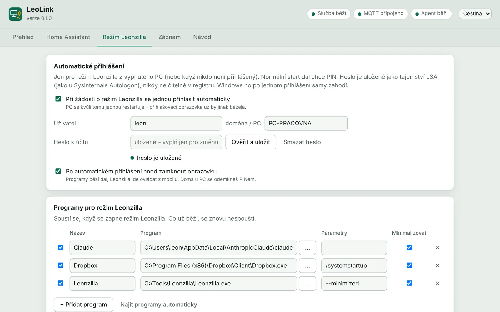
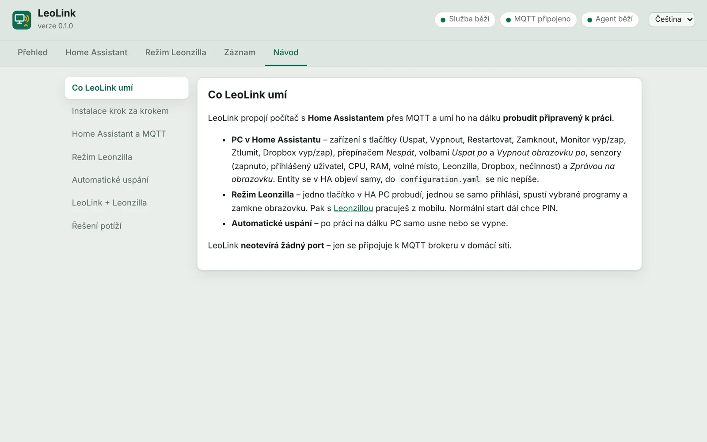
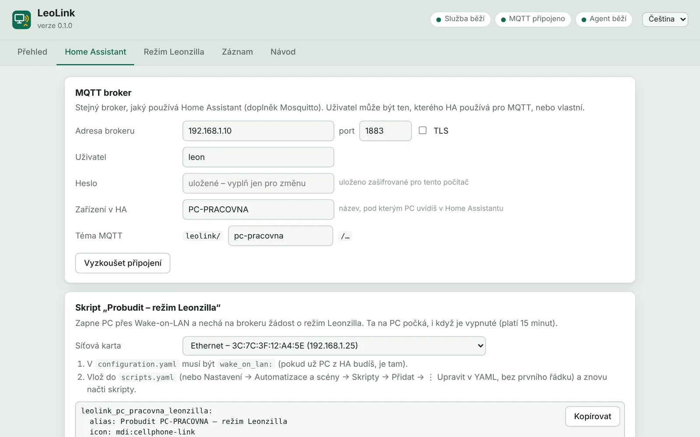

# LeoLink

**Počítač s Windows v Home Assistantu – a probuzení, po kterém je PC rovnou připravené na práci na dálku.**

LeoLink propojí PC s [Home Assistantem](https://www.home-assistant.io/) přes MQTT (doplněk Mosquitto, který většina instalací už má). PC se v HA objeví jako zařízení s tlačítky, senzory, přepínačem a volbami. Do `configuration.yaml` se nic nepíše. LeoLink se k brokeru jen připojuje, na PC se neotevírá žádný port.

Druhá věc je **režim Leonzilla**: jedno tlačítko v HA probudí PC (Wake-on-LAN), **jednou** se samo přihlásí, spustí zaškrtnuté programy (třeba Dropbox a [Leonzillu](https://github.com/Leontech/leonzilla)) a zamkne obrazovku. Pak s Leonzillou pracuješ z mobilu přes VPN. Normální start dál chce PIN.

Okno nastavení je česky i anglicky a má vestavěný návod.

[**Stáhnout LeoLink.zip**](https://github.com/Leontech/LeoLink/releases/latest/download/LeoLink.zip) · Windows 10 / 11 · zdarma, licence MIT · [☕ Kup mi kafe](https://ko-fi.com/leotechcz)

## Co uvidíš v Home Assistantu

| | |
|---|---|
| **Tlačítka** | Uspat, Vypnout, Restartovat, Zamknout, Monitor vypnout / zapnout, Ztlumit, Dropbox vypnout / zapnout, Režim Leonzilla zapnout / ukončit |
| **Přepínač** | *Nespát* – PC samo neusne, dokud je zapnutý |
| **Volby** | *Uspat po* a *Vypnout obrazovku po* (aktivní plán napájení: nikdy, 5 min … 5 h) |
| **Senzory** | Zapnuto (přepne se hned, když PC usne nebo se vypne), přihlášený uživatel, spuštěno, CPU, RAM, volné místo na discích, Leonzilla (běží / pracuje), Dropbox (běží / pozastaven), nečinnost, režim Leonzilla, odpočet automatického uspání |
| **Oznámení** | *Zpráva na obrazovku* – text z automatizace vyskočí na PC |

## Režim Leonzilla

1. Skript v HA (LeoLink ho vygeneruje) nechá na brokeru žádost. Je *retained*, takže počká, než PC naběhne. Zároveň pošle Wake-on-LAN.
2. **PC bylo vypnuté nebo nikdo není přihlášený:** služba LeoLink (běží jako SYSTEM) připraví jedno automatické přihlášení a PC restartuje. Přihlašovací obrazovka už běží a Windows automatické přihlášení čtou jen při startu. Hned po přihlášení ho zase vypne. Nejpozději po 10 minutách ho vypne i tehdy, když se přihlášení nepovedlo.
3. **PC spalo a byl jsi přihlášený:** jen spustí programy, obrazovka zůstane zamčená.
4. **Automatické uspání:** v režimu Leonzilla PC usne nebo se vypne, když se nastavenou dobu nic neděje. Nikdo nesahá na klávesnici ani myš, z mobilu nepřijde žádný požadavek na Leonzillu a neběží žádná její úloha. Jakmile někdo u PC sáhne na klávesnici nebo myš, režim Leonzilla končí a samo nic neusne.

Žádost platí 15 minut. Když se Wake-on-LAN ztratí, PC se po dnech při normálním startu samo nepřihlásí.

## LeoLink + Leonzilla

[Leonzilla](https://github.com/Leontech/leonzilla) nahrává projekty na FTP / SFTP servery, spouští buildy, zálohuje a pushuje na GitHub. Od verze 1.11.20 ji jde ovládat **z mobilu** (jen spouštění karet, přes tvoji VPN). Oba programy spolupracují:

1. **Mimo domov** klepneš v aplikaci Home Assistant na *Probudit – režim Leonzilla*.
2. LeoLink PC probudí, jednou se přihlásí, spustí Leonzillu minimalizovanou (a Dropbox, …) a zamkne obrazovku.
3. V mobilu otevřeš Leonzillu (VPN do domácí sítě, např. WireGuard) a spouštíš karty – nahrát, build, záloha, push.
4. Leonzilla dává LeoLinku vědět, kdy běží úloha a kdy ji mobil naposledy použil. Když se nastavenou dobu nic neděje, **PC samo usne**. Když přijdeš domů a sáhneš na klávesnici, režim Leonzilla prostě skončí.

## Bezpečnost

- **Heslo k Windows** pro automatické přihlášení je uložené jako tajemství LSA (stejně jako u Sysinternals Autologon). Číst ho může jen SYSTEM a správci, nikdy není čitelně v registru. Do Winlogonu se zkopíruje jen pro jedno přihlášení (`AutoLogonCount=1`) a hned potom se smaže.
- Když má účet Microsoft zapnuté *povolit jen přihlášení přes Windows Hello*, Windows heslo nepřijmou a automatické přihlášení nejde. LeoLink na to upozorní a umí volbu vypnout. PIN zůstane.
- **Heslo k MQTT** je zašifrované pro tento počítač (DPAPI). PC může ovládat každý, kdo smí na broker posílat zprávy, proto použij účet se silným heslem.
- LeoLink **neotevírá žádný port**. Služba běží z `C:\Program Files\LeoLink`, kam mohou zapisovat jen správci. Nastavení je v `C:\ProgramData\LeoLink`: uživatelé ho mohou číst, zapisovat jen správci.

## Instalace

1. Z [Releases](https://github.com/Leontech/LeoLink/releases/latest) stáhni `LeoLink.zip`, rozbal kamkoli a spusť `LeoLink.exe` (požádá o oprávnění správce).
2. Záložka **Home Assistant**: adresa brokeru, port, uživatel a heslo → *Vyzkoušet připojení*.
3. Záložka **Režim Leonzilla**: zaškrtni automatické přihlášení a zadej heslo k účtu Windows → *Ověřit a uložit*. U účtu propojeného s účtem Microsoft je to heslo k účtu Microsoft, ne PIN. Pak vyber programy, které se mají spustit.
4. **Přehled** → *Nainstalovat*. LeoLink se zkopíruje do Program Files a založí dvě naplánované úlohy:
   - `LeoLink\Service` – při startu systému, jako SYSTEM (MQTT, napájení, automatické přihlášení),
   - `LeoLink\Agent` – při tvém přihlášení, bez práv správce (spouští programy, zamyká, ovládá monitory, Dropbox a zprávy).
5. Vygenerovaný skript vlož do HA (`scripts.yaml`). Wake-on-LAN potřebuje v `configuration.yaml` řádek `wake_on_lan:`. Případně přidej i vygenerovanou kartu.

PC se musí umět probudit ze sítě (BIOS nebo síťová karta: *Wake on Magic Packet*).

## Podpora

LeoLink je zdarma. Když se ti hodí, můžeš mi [koupit kafe ☕](https://ko-fi.com/leotechcz). Chyby a nápady: [Issues](https://github.com/Leontech/LeoLink/issues) nebo formulář na [leotech.cz](https://leotech.cz/download#leolink).

## Licence

MIT © Leoš Vilím · [leotech.cz](https://leotech.cz)
