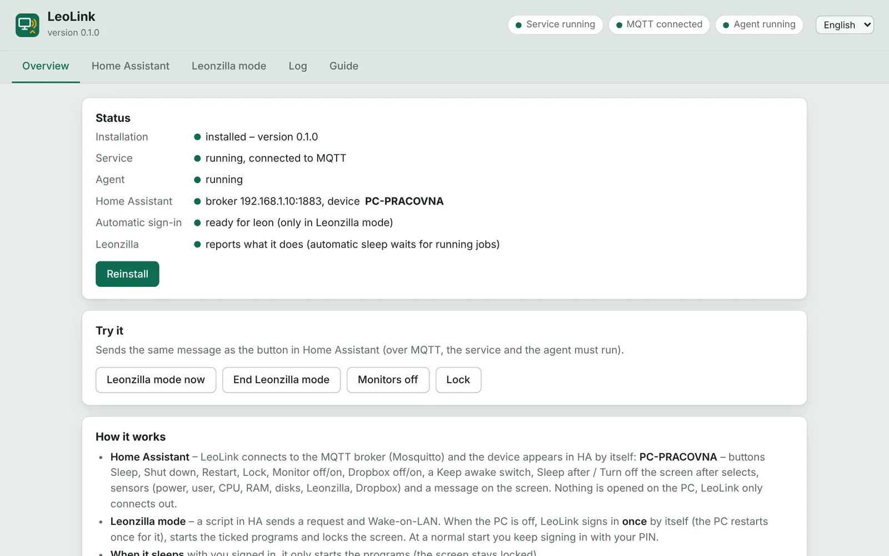
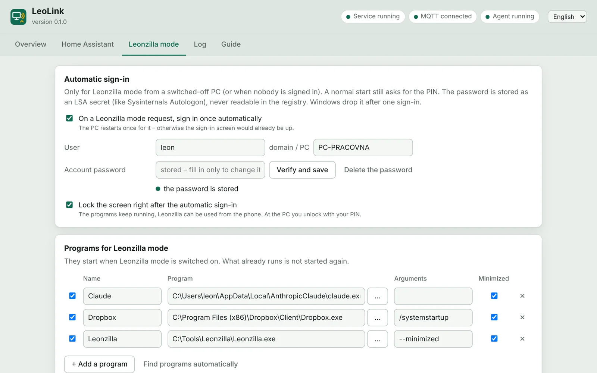
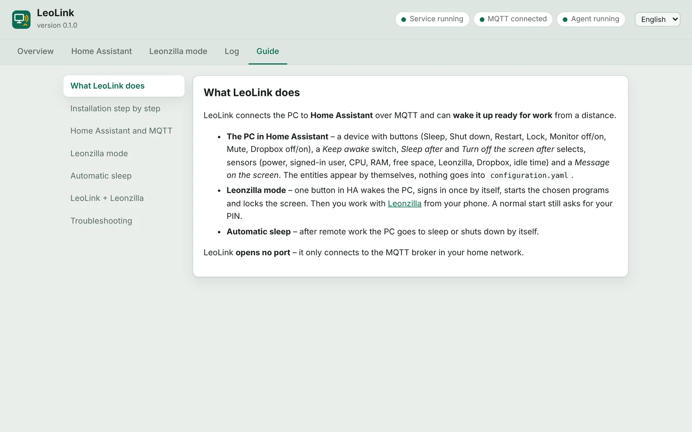
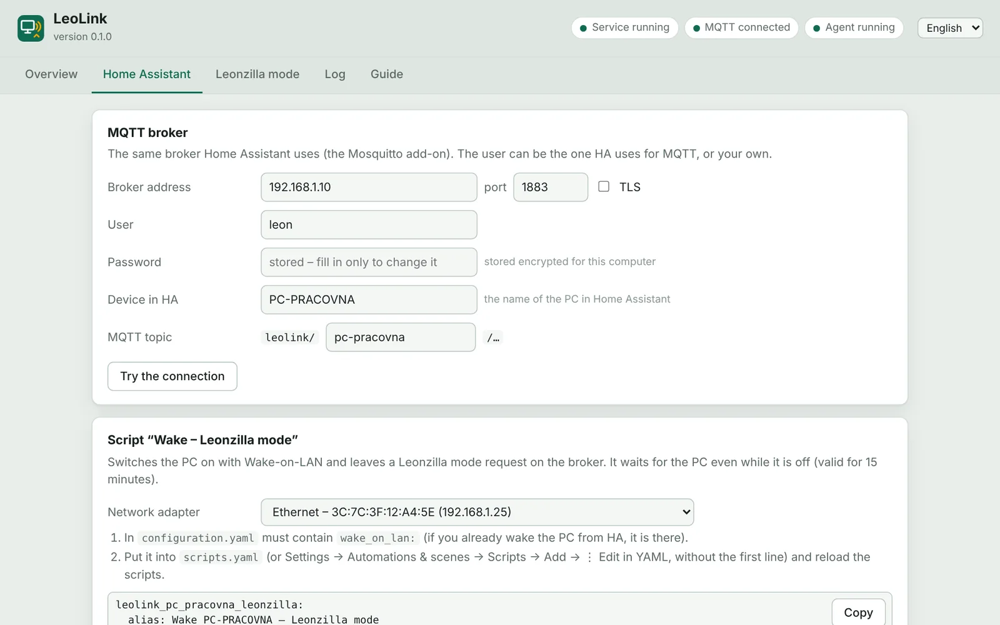

# LeoLink

**Your Windows PC in Home Assistant – and a wake-up that brings the PC up ready for remote work.**

LeoLink connects a Windows PC to [Home Assistant](https://www.home-assistant.io/) over MQTT (the Mosquitto add-on most installations already have). The PC shows up in Home Assistant as a device with buttons, sensors, a switch and selects – nothing to write into `configuration.yaml`. LeoLink only connects out to the broker, so no port is opened on the PC.

Its second job is **Leonzilla mode**: one button in Home Assistant wakes the PC (Wake-on-LAN), signs in **once** automatically, starts the programs you ticked (for example Dropbox and [Leonzilla](https://github.com/Leontech/leonzilla)) and locks the screen. You can then work with Leonzilla from your phone over a VPN. A normal start keeps asking for your PIN.

The settings window is in English and Czech, with a built-in guide.

[**Download LeoLink.zip**](https://github.com/Leontech/LeoLink/releases/latest/download/LeoLink.zip) · Windows 10 / 11 · free, MIT License · [☕ Buy me a coffee](https://ko-fi.com/leotechcz)



## What you get in Home Assistant

| | |
|---|---|
| **Buttons** | Sleep, Shut down, Restart, Lock, Monitor off / on, Mute, Dropbox off / on, Leonzilla mode on / off |
| **Switch** | *Keep awake* – the PC does not go to sleep on its own while it is on |
| **Selects** | *Sleep after* and *Turn off the screen after* (the active power plan: never, 5 min … 5 h) |
| **Sensors** | On (online / offline – switches at once when the PC sleeps or shuts down), signed-in user, boot time, CPU, RAM, free space per disk, Leonzilla (running / working), Dropbox (running / paused), idle time, Leonzilla mode, automatic sleep countdown |
| **Notify** | *Message on the screen* – text from an automation pops up on the PC |

## Leonzilla mode

1. A Home Assistant script (LeoLink generates it) leaves a request on the broker – *retained*, so it waits while the PC is still off – and sends Wake-on-LAN.
2. **PC was switched off / nobody signed in:** the LeoLink service (running as SYSTEM) prepares one automatic sign-in and restarts the PC (the sign-in screen is already up, Windows reads the automatic sign-in only at start). After the sign-in it switches the automatic sign-in off again – at the latest after 10 minutes, even if the sign-in failed.
3. **PC was asleep with you signed in:** only the programs are started; the screen stays locked.
4. **Automatic sleep:** in Leonzilla mode the PC goes to sleep (or shuts down) when nothing has happened for a set time – nobody at the keyboard or mouse, no request from the phone to Leonzilla, no running Leonzilla job. As soon as somebody touches the keyboard or mouse at the PC, Leonzilla mode ends and nothing sleeps by itself.

A request is valid for 15 minutes – if Wake-on-LAN gets lost, the PC will not sign in by itself days later on a normal start.



## LeoLink + Leonzilla

[Leonzilla](https://github.com/Leontech/leonzilla) uploads your projects to FTP / SFTP servers, runs builds, makes backups and pushes to GitHub – and since 1.11.20 it can be used **from a phone** (running cards only, over your VPN). The two programs work together:

1. **Away from home**, tap *Wake – Leonzilla mode* in the Home Assistant app.
2. LeoLink wakes the PC, signs in once, starts Leonzilla minimized (and Dropbox, …) and locks the screen.
3. Open Leonzilla on the phone (VPN into the home network, e.g. WireGuard) and run your cards – upload, build, back up, push.
4. Leonzilla tells LeoLink when a job is running and when the phone last used it; when nothing has happened for the set time, **the PC goes to sleep by itself**. If you come home and touch the keyboard, Leonzilla mode simply ends.



## Security

- **The Windows password** for the automatic sign-in is stored as an LSA secret (like Sysinternals Autologon) – readable only by SYSTEM and administrators, never in plain text in the registry. It is copied to Winlogon only for the one sign-in, with `AutoLogonCount=1`, and removed right after it.
- If your Microsoft account is set to *only allow Windows Hello sign-in*, Windows accepts no password and the automatic sign-in cannot work – LeoLink tells you and can switch that option off (your PIN stays).
- **The MQTT password** is encrypted for the computer (DPAPI). Anybody who may publish to the broker can control the PC – use a broker account with a strong password.
- LeoLink opens **no port**. The service runs from `C:\Program Files\LeoLink` (only administrators can change it); settings live in `C:\ProgramData\LeoLink` (users can read, only administrators write).

## Installation

1. Download `LeoLink.zip` from [Releases](https://github.com/Leontech/LeoLink/releases/latest), unpack it anywhere and run `LeoLink.exe` (it asks for administrator rights).
2. **Home Assistant** tab: broker address, port, user and password → *Try the connection*.
3. **Leonzilla mode** tab: tick the automatic sign-in, enter the password of your Windows account (for an account linked to a Microsoft account: the Microsoft account password, not the PIN) → *Verify and save*. Pick the programs to start.
4. **Overview** → *Install*. LeoLink copies itself to Program Files and creates two scheduled tasks:
   - `LeoLink\Service` – at system start, as SYSTEM (MQTT, power, automatic sign-in),
   - `LeoLink\Agent` – at your sign-in, without administrator rights (starts programs, lock, monitors, Dropbox, messages).
5. Copy the generated script into Home Assistant (`scripts.yaml`) – Wake-on-LAN needs `wake_on_lan:` in `configuration.yaml`. Optionally add the generated dashboard card.

The PC must be allowed to wake up from the network (BIOS / network adapter: *Wake on Magic Packet*).



## Building

Go 1.24, Windows 10/11 (WebView2):

```
GOOS=windows GOARCH=amd64 CGO_ENABLED=0 go build -trimpath -ldflags "-H windowsgui -s -w" -o LeoLink.exe .
```

`LeoLink.exe` has three roles: no argument = settings window, `--service`, `--agent`. On other systems the program builds with stand-ins that only record what would happen – used to test the logic against an MQTT broker.

## Support

LeoLink is free. If it is useful to you, you can [buy me a coffee ☕](https://ko-fi.com/leotechcz). Bugs and ideas: [Issues](https://github.com/Leontech/LeoLink/issues) or the form on [leotech.cz](https://leotech.cz/download#leolink).

## License

MIT © Leoš Vilím · [leotech.cz](https://leotech.cz)
